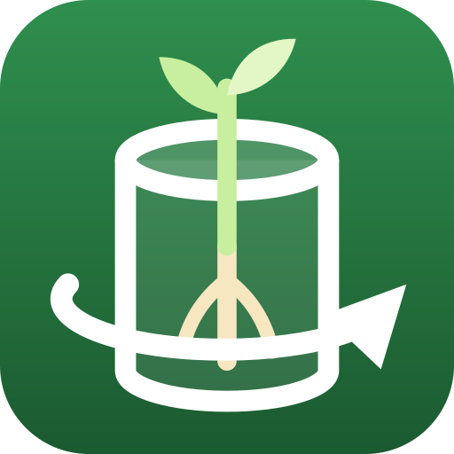
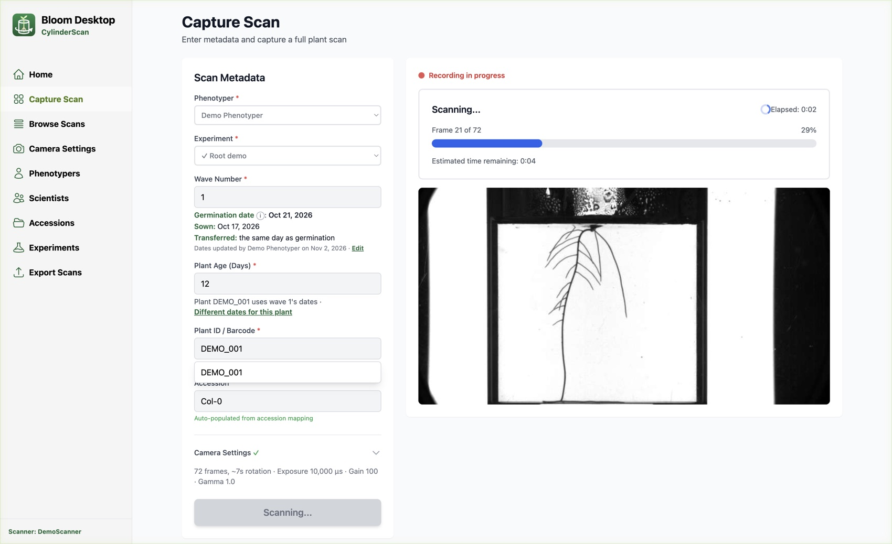
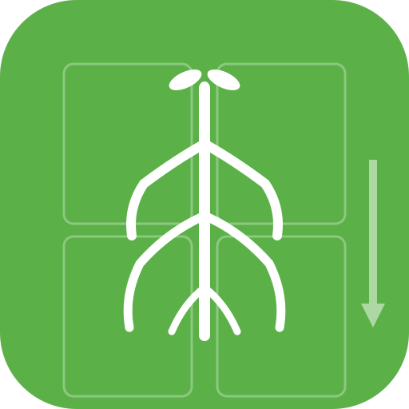
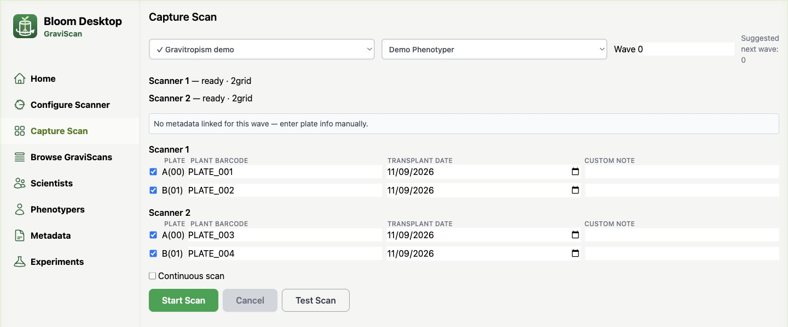

# bloom-desktop

Electron + React app that runs plant scanners and keeps their scans.

<table>
  <tr>
    <td width="50%" align="center" valign="top">
      <br>
      <b>CylinderScan</b><br>
      Rotates a plant in a water-filled cylinder and captures frames with a Basler camera, turned by a stepper motor through an NI-DAQ (Windows stations).<br><br>
      
    </td>
    <td width="50%" align="center" valign="top">
      <br>
      <b>GraviScan</b><br>
      Scans plates on Epson V600 flatbed scanners over time (Linux stations).<br><br>
      
    </td>
  </tr>
</table>

<sub>Screenshots show demo data.</sub>

Scans are saved locally and can be uploaded to [Bloom](https://bloom.salk.edu) and backed up to Box. It can also run without Bloom (see [Using Bloom Desktop without Bloom](#using-bloom-desktop-without-bloom)).

## User guide

[Bloom Desktop user guide (PDF)](docs/user-guide/Bloom_Desktop_User_Guide.pdf), for CylinderScan operators:

- **Part A**: Salk stations, connected to Bloom.
- **Part B**: using Bloom Desktop outside Salk, without Bloom.
- **Source**: [docs/user-guide/user_guide.html](docs/user-guide/user_guide.html)

## Installing

Download the latest release from [Releases](https://github.com/Salk-Harnessing-Plants-Initiative/bloom-desktop/releases): `Bloom-Desktop-<version>-Setup.exe` for Windows, `bloom-desktop_<version>_amd64.deb` for Linux. On first start the app opens Machine Configuration (also reachable with Ctrl+Shift+,).

Before the first start:

- **CylinderScan**: install the Basler Pylon SDK and the NI-DAQmx runtime.
- **GraviScan**: install the Epson `epkowa` SANE driver ([docs/GRAVISCAN_SCANNER_DRIVER_SETUP.md](docs/GRAVISCAN_SCANNER_DRIVER_SETUP.md)).
- **Moving from bloom-desktop-pilot**: convert its database first ([docs/PILOT_COMPATIBILITY.md](docs/PILOT_COMPATIBILITY.md)).

## Prerequisites

- **Node.js**: >=20.0.0
- **npm**: >=8.0.0
- **Python**: >=3.11 (managed via uv)
- **uv**: Python package manager ([installation instructions](https://docs.astral.sh/uv/getting-started/installation/))

### Hardware Dependencies (for production use)

- **Basler Pylon SDK** and **NI-DAQmx Runtime**: CylinderScan
- **Epson `epkowa` SANE driver**: GraviScan (Linux; see [docs/GRAVISCAN_SCANNER_DRIVER_SETUP.md](docs/GRAVISCAN_SCANNER_DRIVER_SETUP.md))

Without hardware, the app runs with mock camera, DAQ and scanners.

### Hardware

What the CylinderScan code drives, as set up at Salk:

- **Camera**: Basler acA2000-50gm (GigE, mono), set up by IP address in Machine Configuration.
- **Turntable**: a stepper motor whose driver takes step and direction signals from an NI CompactDAQ digital output module (device `cDAQ1Mod1`, lines 0 and 1).
- **Drive**: 20,000 microsteps per motor turn and 42:60 gearing to the turntable (28,571 steps per turntable turn). Change these in `src/types/daq.ts` for different hardware.
- **Scan**: 72 frames per turn and 7 s per turn by default, set in Machine Configuration.

## Stations

Releases are installed on the scanning stations with **Actions → Deploy** (see [docs/STATION_SETUP.md](docs/STATION_SETUP.md)). Each deploy is recorded in the station's GitHub environment, linked to the release it installed; **Actions → Station versions** prints which version every station has.

| Station | Location         | Scanner     | Last deploy                                                                                                             | History                                                                                               |
| ------- | ---------------- | ----------- | ----------------------------------------------------------------------------------------------------------------------- | ----------------------------------------------------------------------------------------------------- |
| pc1     | WIF room 104/105 | FastScanner |  | [deploys](https://github.com/Salk-Harnessing-Plants-Initiative/bloom-desktop/deployments/station-pc1) |
| pc2     | CQuesta          | SlowScanner |  | [deploys](https://github.com/Salk-Harnessing-Plants-Initiative/bloom-desktop/deployments/station-pc2) |

The badge shows whether the station's last deploy succeeded; the history lists every version deployed, when, and who approved it. Installs done by hand aren't recorded.

## Architecture

- **Frontend**: Electron + React + TypeScript
- **Hardware**: Python subprocesses (Basler Pylon camera + NI-DAQ for CylinderScan; SANE for GraviScan)
- **Database**: Prisma ORM + SQLite (`~/.bloom/data/bloom.db`); machine settings in `~/.bloom/.env`
- **Uploads**: Bloom (Supabase) and Box (rclone), both optional
- **Python Management**: uv + pyproject.toml
- **Distribution**: PyInstaller bundled with Electron
- **Build System**: Electron Forge + Webpack

## Environment Variables

See `.env.example` for the full, authoritative list with inline
comments. Highlights for GraviScan operators (V600 wedge follow-ups,
#228 + #236):

- **`BLOOM_GRAVISCAN_SLACK_WEBHOOK_URL`** — Slack Incoming Webhook URL
  used to alert operators when the wedge detector matches a known V600
  USB failure signature. Absent or empty ⇒ the Slack notifier is
  disabled (no-op); this is the default. Configured via `~/.bloom/.env`
  (loaded by `config-store.ts`'s `loadEnvConfig`/`saveEnvConfig`), not
  the repo-root `.env`.
- **`LIBUSB_ENDPOINT_RECOVERY`** — toggles the `libusb_clear_halt`-on-
  bulk-timeout wrapper that works around the V600 USB wedge at the
  driver level. Default ON (wrapper active); set to the case-insensitive
  string `"false"` to disable it. Also configured via `~/.bloom/.env`.
- **`GRAVISCAN_SYSTEM_NAME`** — identifies which physical rig produced a
  given GraviScan upload or Box backup, for multi-rig fleets. Absent or
  empty ⇒ uploads and Box-backup paths omit system-name attribution;
  this is the default. Configured via `~/.bloom/.env` (loaded by
  `config-store.ts`'s `loadEnvConfig`/`saveEnvConfig`), not the
  repo-root `.env`.
- **`BLOOM_NOT_CONNECTED`** — set to `true` on a computer that doesn't use
  Bloom (see [Using Bloom Desktop without Bloom](#using-bloom-desktop-without-bloom)).
  Absent ⇒ Bloom is on; this is the default. Written by the Connect to Bloom
  switch in Machine Configuration to `~/.bloom/.env`.

## Using Bloom Desktop without Bloom

Labs without a Bloom account can run CylinderScan or GraviScan on their own
computer:

1. Install the latest release (see [Installing](#installing)).
2. Open Machine Configuration (it opens on first start; later with Ctrl+Shift+,, Cmd+Shift+, on macOS).
3. Untick **Connect to Bloom**, type a scanner name (letters, numbers, `-` and
   `_`), set the camera IP and scans folder, and save. Restart the app.

With Bloom off, scans stay in the scans folder (CylinderScan PNGs, GraviScan
TIFs) and nothing is sent to Bloom or Box: the upload and Backup to Box buttons
are hidden. CylinderScan scans can be copied elsewhere with Export Scans. The
species list is kept on this computer: pick **Add a species…** in the species
list to add one, or **Remove from list** to take one out.

## Project Structure

```
bloom-desktop/
├── src/
│   ├── main/        # Electron main process: IPC handlers, config, uploads, Python subprocesses
│   ├── renderer/    # React UI
│   ├── types/       # Shared TypeScript types
│   └── utils/       # Code shared by main and renderer
├── python/          # Hardware backend (camera, DAQ, GraviScan scanners), bundled with PyInstaller
├── prisma/          # SQLite schema and migrations
├── tests/           # unit (Vitest), integration, e2e (Playwright), deploy
├── deploy/          # Station deploy scripts
├── docs/            # Setup, packaging, testing and station docs
└── scripts/         # Build helpers
```

## Development Setup

### 1. Install Dependencies

The Bloom packages (`@salk-harnessing-plants-initiative/bloom-js`, `bloom-fs`) are private on GitHub Packages, so npm needs a token:

```bash
cp .npmrc.example .npmrc                 # .npmrc is gitignored
export NODE_AUTH_TOKEN=<GitHub token with read:packages>
npm install
npx prisma generate

# Python hardware backend (also runs uv sync)
npm run build:python
```

### 2. Available Scripts

#### Development

```bash
# Start development server
npm start

# Lint TypeScript/JavaScript files
npm run lint

# Format code with Prettier
npm run format

# Check formatting without modifying
npm run format:check
```

#### Python Backend

```bash
# Build Python executable (PyInstaller)
npm run build:python

# Run Python unit tests
npm run test:python
```

**PyInstaller Documentation**: See [python/PYINSTALLER.md](python/PYINSTALLER.md) for:

- How the Python build process works
- Troubleshooting bundling issues
- Adding new Python dependencies
- Understanding module import paths

#### Database

```bash
# Generate Prisma Client (run after schema changes)
npm run prisma:generate

# Create and apply database migrations
npm run prisma:migrate

# Seed database with test data
npm run prisma:seed

# Open Prisma Studio (visual database browser)
npm run prisma:studio
```

For complete database documentation, see [docs/DATABASE.md](docs/DATABASE.md).

#### Testing

```bash
# Test Python IPC communication (builds Python if needed)
npm run test:ipc

# Test camera integration with mock camera
npm run test:camera

# Test DAQ integration with mock DAQ
npm run test:daq

# Test scanner integration with mock hardware
npm run test:scanner

# Test scanner-database integration
npm run test:scanner-database

# Test database initialization in dev mode
npm run test:dev:database

# Test database initialization in packaged app (run after npm run package)
npm run test:package:database

# Test packaged app (run after npm run package)
npm run test:package

# E2E tests (requires dev server running)
# Terminal 1: npm run start
# Terminal 2: npm run test:e2e
npm run test:e2e
```

**Testing Documentation**:

- **E2E**: See [docs/E2E_TESTING.md](docs/E2E_TESTING.md) for end-to-end testing instructions ⚠️ **Requires dev server**
- **Camera**: See [docs/CAMERA_TESTING.md](docs/CAMERA_TESTING.md) for camera testing instructions
- **DAQ**: See [docs/DAQ_TESTING.md](docs/DAQ_TESTING.md) for DAQ turntable testing instructions
- **Database**: See [docs/DATABASE.md](docs/DATABASE.md) for database testing instructions

#### Packaging & Distribution

```bash
# Package app for distribution (includes Python executable)
npm run package

# Create installers (includes Python executable)
npm run make
```

**Important**: Bloom Desktop uses Prisma ORM, which requires special packaging configuration for Electron. Prisma's binary query engines cannot be bundled inside the ASAR archive and are copied to the `Resources/` directory using dynamic module loading. See [docs/PACKAGING.md](docs/PACKAGING.md) for detailed information on:

- How Prisma packaging works
- Troubleshooting packaged apps
- Platform-specific considerations

### 3. Script Details

| Script                          | Description                                       | Prerequisites   |
| ------------------------------- | ------------------------------------------------- | --------------- |
| `npm start`                     | Launch Electron app in development mode           | None            |
| `npm run build:python`          | Build Python executable with PyInstaller          | uv installed    |
| `npm run test:python`           | Run Python unit tests with pytest (80%+ coverage) | uv installed    |
| `npm run test:ipc`              | Integration test for Python ↔ TypeScript IPC     | Python built    |
| `npm run test:camera`           | Integration test for camera interface (mock)      | Python built    |
| `npm run test:daq`              | Integration test for DAQ interface (mock)         | Python built    |
| `npm run test:scanner`          | Integration test for scanner workflow (mock)      | Python built    |
| `npm run test:scanner-database` | Integration test for scanner-database persistence | Python built    |
| `npm run test:dev:database`     | Test database initialization in dev mode          | Python built    |
| `npm run test:package:database` | Test database initialization in packaged app      | Package created |
| `npm run test:package`          | Verify Python bundled in packaged app             | Package created |
| `npm run package`               | Create distributable app bundle                   | Python built    |
| `npm run make`                  | Create platform-specific installers               | Python built    |
| `npm run lint`                  | Check TypeScript/JavaScript code style            | None            |
| `npm run format`                | Auto-format code with Prettier                    | None            |
| `npm run format:check`          | Check code formatting                             | None            |

## Testing

### Test Coverage

- **TypeScript**: Vitest unit tests in `tests/unit/`, run on Linux, macOS and Windows in CI
- **Python**: pytest, 80% coverage required (`npm run test:python`)
- **Integration and E2E**: mock-hardware IPC, scanner and database tests, and Playwright against the dev build

### Running Tests

```bash
# TypeScript unit tests (Vitest)
npm run test:unit

# Python unit tests (pytest)
npm run test:python

# Integration: Test IPC communication
npm run test:ipc

# Integration: Test camera interface
npm run test:camera

# Integration: Test DAQ interface
npm run test:daq

# Integration: Verify packaged app
npm run package
npm run test:package
```

## Contributing

Open PRs against `development`. All PRs should:

- Include tests for new behaviour (Python: 80%+ coverage)
- Pass linting, formatting and the CI checks
- Reference the related issue, if there is one

Releases are made from `main` ([docs/RELEASING.md](docs/RELEASING.md)).

## License

BSD-2-Clause - See [LICENSE](LICENSE) file for details.

## Links

- [Releases](https://github.com/Salk-Harnessing-Plants-Initiative/bloom-desktop/releases)
- [Pilot Repository](https://github.com/eberrigan/bloom-desktop-pilot/tree/benfica/add-testing)
